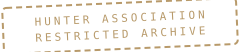

FIELD NOTES × HUNTER'S ARCHIVE

# Caio Vinícius Ferreira

LICENSE № 013 — PROVISIONAL

*I build systems worth investigating.*

fig. 01 — the survey continues into unmapped terrain

SPECIALTY — BACKEND SYSTEMS · APIS · INFRASTRUCTURE
CORE — TYPESCRIPT · ELIXIR · POSTGRESQL · DOCKER
EXPLORING — JAVA · RUST

---

###  01 × Hunter Record
who keeps this archive

Software Engineering student working mostly on the backend: APIs, distributed systems and the infrastructure around them. Most of what I know comes from building — services, experiments and the occasional over-engineered side project, all logged in the case files below.

I like working close to the system: Linux as a daily driver, Docker for everything that moves, and a growing interest in how software behaves under concurrency and failure.

---

###  02 × Fieldwork
case files from the archive — one principal investigation, four secondary expeditions

**CASE FILE 001 · [wagering-processor](https://github.com/Caio13Vinni/wagering-processor)**
principal investigation — `TypeScript` `NestJS` `Bun` `PostgreSQL` `SQS (LocalStack)` `MikroORM`

Distributed wagering transaction processor (BET · WIN · LOSS · REFUND · ROLLBACK) with ledger-based accounting, persistent idempotency and at-least-once messaging. The most complete system in the archive.

[→ explore the repository](https://github.com/Caio13Vinni/wagering-processor)

**CASE FILE 002 · [crud-api-rust](https://github.com/Caio13Vinni/crud-api-rust)** — `Rust` `Docker`
A learning expedition into Rust: a small containerized CRUD API.

**CASE FILE 003 · [cardapio](https://github.com/Caio13Vinni/cardapio)** — `Vue` `PHP`
A digital menu application — Vue on the front, PHP on the back.

**FIELD EQUIPMENT · [dotfiles](https://github.com/Caio13Vinni/dotfiles)** — `Shell` `Lua`
The field kit: personal Linux environment configuration. Arch, btw.

---

###  03 × Technical Inventory
equipment manifest, by function

**languages** — Java · Rust · Elixir · TypeScript

**frameworks & runtimes** — Spring · Phoenix · Node.js

**frontend** — React · Angular · Vue

**data & infrastructure** — PostgreSQL · Docker · Terraform · AWS · Linux

△ Java & Rust — currently under active survey; the rest has seen fieldwork.

---

###  04 × Activity Log
telemetry from the field

  
  

---

###  05 × Signal
no spell card required — these channels reach base camp

— email: [contatocaio.ferreira7@gmail.com](mailto:contatocaio.ferreira7@gmail.com)
— linkedin: [caio-vinícius-ferreira](https://www.linkedin.com/in/caio-vin%C3%ADcius-ferreira)
— github: [Caio13Vinni](https://github.com/Caio13Vinni)

---

× × ×

Observe first. Act after.

FIELD NOTES Nº 013 — THE SURVEY CONTINUES.

<!-- water divination result: specialist -->
